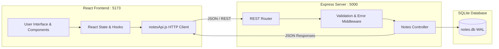

# 📝 Notes Studio — Modern Full-Stack Notes Application

A full-stack, responsive personal workspace and notes management application built with **React**, **Node.js & Express**, and **SQLite**. Designed with clean architecture, instant search filtering, real-time UI synchronization, glassmorphism dark/light design, and zero-configuration database persistence.

---

## 🌟 Features

- **End-to-End CRUD**: Compose, view, edit, pin, categorize, and delete notes seamlessly.
- **Instant Search Filtering**: Real-time debounce filtering across note titles, contents, and tags with zero lag.
- **Adaptive Layout Modes**: Switch dynamically between responsive **Grid (Cards)** and **Compact List** views across desktop, tablet, and mobile.
- **Pin & Priority Management**: Pin critical notes to keep them locked at the top of your workspace.
- **Visual Color Palette & Tags**: Categorize notes using color coding (Indigo, Sky, Emerald, Amber, Rose, Purple, Slate) and searchable hashtags.
- **Glassmorphic Modern UI**: Curated typography (`Inter` & `Outfit`), smooth micro-animations, active glow indicators, and persistent Dark/Light mode.
- **Resilient Network Handling**: Instant optimistic updates paired with toast alerts, network error notifications, and automated retry mechanisms.
- **Zero-Config Database**: Self-contained SQLite database with Write-Ahead Logging (WAL) enabled for optimal concurrent read/write throughput without needing external database servers.

---

## 📸 Screenshots & UI Preview

### Desktop Dashboard & Grid Layout
```
+----------------------------------------------------------------------------------+
|  ✨ Notes Studio    [Notes: 4]  [📌 Pinned: 2]     [Grid|List]  [🌙]  [+ New Note] |
|----------------------------------------------------------------------------------|
|  [ 🔍 Search notes by title, content, or tags...                           (X) ] |
|  [All Notes]  [#Tips]  [#Guide]  [#Sprint]  [#Ideas]                             |
|                                                                                  |
|  📌 PINNED NOTES (2)                                                             |
|  +-----------------------------+    +-----------------------------+             |
|  | 🚀 Welcome to Notes Studio  |    | 💡 Pro Tips & Productivity  |             |
|  | Modern full-stack workspace |    | Real-time search & shortcuts|             |
|  | #Welcome #Guide             |    | #Tips #Shortcuts            |             |
|  | ⏱ Just now     [📋][✏️][🗑] |    | ⏱ 5m ago        [📋][✏️][🗑] |             |
|  +-----------------------------+    +-----------------------------+             |
|                                                                                  |
|  📄 OTHER NOTES (2)                                                              |
|  +-----------------------------+    +-----------------------------+             |
|  | 🎯 Sprint Goals & Tasks     |    | 🎨 UI Redesign Specs        |             |
|  | 1. API CRUD verification    |    | Tailwind / Vanilla CSS Glass|             |
|  | #Sprint #Todo               |    | #Design #Vite               |             |
|  | ⏱ 2h ago        [📋][✏️][🗑] |    | ⏱ 1d ago        [📋][✏️][🗑] |             |
|  +-----------------------------+    +-----------------------------+             |
+----------------------------------------------------------------------------------+
```

*(Place your exported application screenshots in `./docs/screenshots/`)*

---

## 🏗️ Architecture Overview

The project is structured as a clean **Monorepo** strictly separating the client (presentation & user interaction) and server (business logic, validation & persistence).

```
notes-application/
├── package.json              # Root monorepo scripts (concurrently runner)
├── README.md                 # Complete project documentation
├── server/                   # Backend Express & SQLite API
│   ├── package.json          # Backend dependencies & start scripts
│   ├── server.js             # Express app entrypoint, middleware, and CORS
│   ├── .env.example          # Environment variable template
│   ├── database/
│   │   ├── db.js             # SQLite connection, WAL mode & seed logic
│   │   ├── schema.sql        # Table definitions and index creation
│   │   └── notes.db          # SQLite persistent database file (auto-generated)
│   ├── controllers/
│   │   └── notesController.js# CRUD query execution & business logic
│   ├── routes/
│   │   └── notesRoutes.js    # RESTful routing endpoints
│   └── middleware/
│       ├── errorHandler.js   # Centralized error handler and 404 catcher
│       └── validateNote.js   # Request body validation and sanitization
└── client/                   # Frontend React & Vite Web App
    ├── package.json          # Frontend dependencies (React 19, Lucide, Vite)
    ├── vite.config.js        # Vite build tool configuration
    ├── index.html            # HTML5 shell with Google Fonts
    └── src/
        ├── main.jsx          # React DOM entry point
        ├── App.jsx           # Root orchestrator (state, search, toasts)
        ├── index.css         # Custom design system (CSS variables & dark mode)
        ├── api/
        │   └── notesApi.js   # HTTP fetch client with network error catching
        ├── hooks/
        │   └── useDebounce.js# Debounced search input hook
        ├── utils/
        │   └── formatDate.js # Relative time calculation ("5m ago", "2d ago")
        └── components/
            ├── Header.jsx    # Navigation, metrics, view switch, theme switch
            ├── SearchBar.jsx # Search bar with clear button & tag pills
            ├── NoteForm.jsx  # Collapsible compose card with color palette
            ├── NoteCard.jsx  # Card & list item with copy, pin & delete actions
            ├── NoteModal.jsx # Full-featured edit & inspection modal (Esc / Ctrl+Enter)
            ├── Toast.jsx     # Non-blocking animated alert notifications
            └── EmptyState.jsx# Interactive empty workspace illustration
```

### Client-Server Separation Model



---

## 🚀 Quickstart & Local Setup

### Prerequisites
- **Node.js**: v18.0.0 or later (v20+ or v24 recommended)
- **npm**: v9.0.0 or later

### 1. Installation

Clone or extract the repository and install all root, backend, and frontend dependencies with one command:

```bash
# From the project root
npm run install:all
```

Alternatively, you can install them individually:
```bash
# Install root tools
npm install

# Install backend dependencies
cd server
npm install

# Install frontend dependencies
cd ../client
npm install
```

### 2. Environment Configuration

The backend comes preconfigured to use sensible defaults. If needed, configure the server environment variables in `server/.env`:

```env
PORT=5000
NODE_ENV=development
CLIENT_URL=http://localhost:5173
DB_PATH=./database/notes.db
```

### 3. Run Both Frontend and Backend Concurrently

From the root directory, launch the entire application with a single command:

```bash
npm run dev
```

This starts:
- **Backend API**: `http://localhost:5000`
- **Frontend App**: `http://localhost:5173`

*(To run backend or frontend independently: `npm run server` or `npm run client`)*

---

## 📡 RESTful API Documentation

| Method | Endpoint | Description | Request Body / Query Params |
| :--- | :--- | :--- | :--- |
| `GET` | `/api/health` | Service health status | None |
| `GET` | `/api/notes` | Fetch notes (filtered & sorted) | `?search=query&tag=work&pinned=true` |
| `GET` | `/api/notes/:id` | Get note by ID | None |
| `POST` | `/api/notes` | Create a new note | `{ title, content, color, is_pinned, tags }` |
| `PUT` | `/api/notes/:id` | Update an existing note | `{ title, content, color, is_pinned, tags }` |
| `PATCH`| `/api/notes/:id/pin`| Toggle pinned status | None |
| `DELETE`| `/api/notes/:id` | Permanently delete note | None |

### Sample JSON Payload (`POST /api/notes`)

```json
{
  "title": "Weekly Planning & Prioritization",
  "content": "Review client deliverable milestones and finalize sprint review deck.",
  "color": "#6366f1",
  "is_pinned": 1,
  "tags": "Planning,Work"
}
```

---

## 🧪 Testing the Setup

You can verify the backend directly using `curl` or PowerShell:

```bash
# Health check
curl http://localhost:5000/api/health

# Fetch notes
curl http://localhost:5000/api/notes

# Search notes
curl "http://localhost:5000/api/notes?search=Welcome"
```

---

## 📄 License

This project is licensed under the MIT License.
